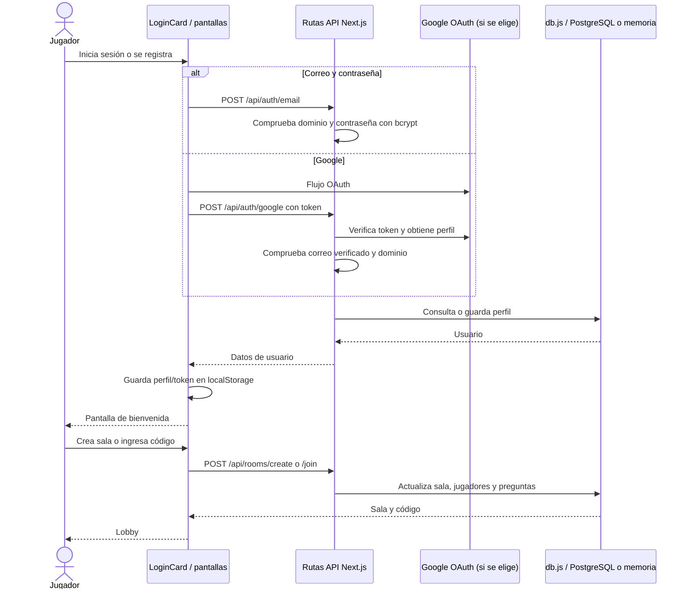
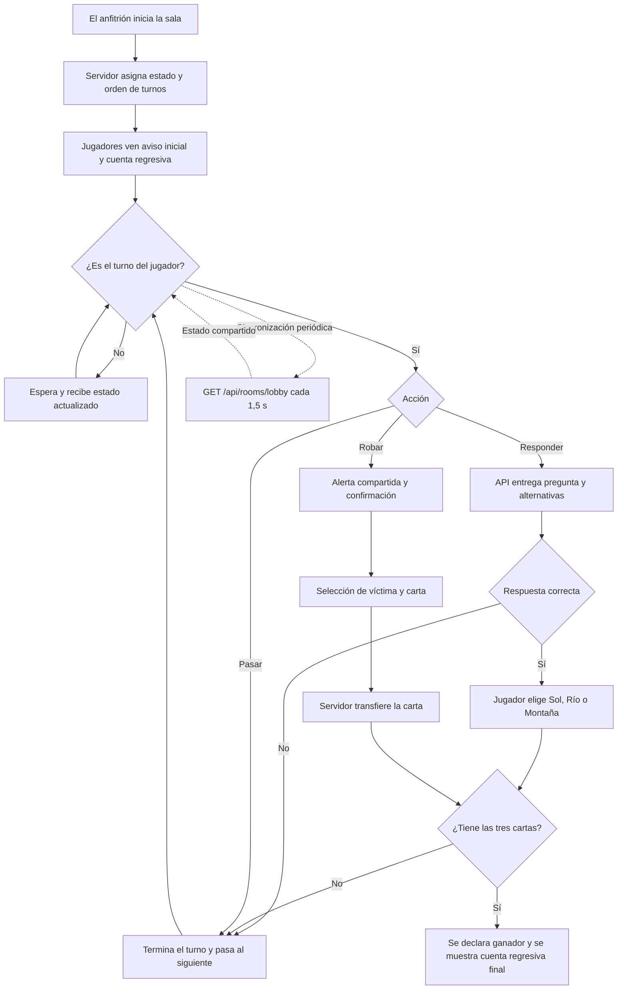

# Informe técnico web — QuizPekuy

**Fecha de revisión:** 16 de noviembre de 2026  
**Proyecto revisado:** `quizpekuy`  
**Propósito:** describir la arquitectura, tecnologías, conexión entre archivos, recorrido de ejecución, elementos distintivos y observaciones técnicas del juego.

## 1. Resumen del proyecto

QuizPekuy es una aplicación web de preguntas por turnos, con ambientación de aventura y un personaje de cuy dorado. Permite autenticarse con correo institucional o Google, crear una sala con un código de cuatro cifras, invitar jugadores y competir respondiendo preguntas para reunir una colección de tres cartas: **Sol, Río y Montaña**. También incluye una acción para intentar robar cartas a otro participante.

La interfaz está implementada como una aplicación cliente de Next.js. Las rutas API del mismo proyecto procesan autenticación, salas, lobby y acciones de juego. Los datos pueden manejarse con PostgreSQL cuando hay una conexión activa; el proyecto también incorpora un almacén en memoria como alternativa.

## 2. Tecnologías utilizadas

| Tecnología | Versión o uso observado | Función en el proyecto |
|---|---|---|
| JavaScript | ES Modules | Lógica de interfaz, rutas API y acceso a datos. |
| Next.js | 16.4.6 | Aplicación web, enrutamiento por archivos y endpoints del servidor. |
| React / React DOM | 19.3.0 | Componentes, navegación por estado y actualización de la interfaz. |
| CSS | `app/globals.css` | Tema visual, componentes, animaciones y reglas adaptables. |
| PostgreSQL | Esquema preparado en `database.sql`; cliente `pg` 8.23.1 | Persistencia relacional opcional de usuarios, salas, jugadores y preguntas. |
| `bcryptjs` | 3.0.3 | Hash y verificación de contraseñas para cuentas con correo. |
| Google OAuth | `@react-oauth/google` 0.13.5 | Inicio de sesión con Google y validación del perfil/token en servidor. |
| Node.js / npm | Entorno de ejecución | Ejecución de Next.js y administración de dependencias. |
| Mermaid | Diagramas incluidos en este informe | Representación de módulos y flujos de ejecución. |

La hoja de estilos importa las fuentes **Cinzel** e **Inter** desde Google Fonts. Los valores de configuración se leen desde variables de entorno; el archivo `.env.local` no se reproduce en este informe.

## 3. Estructura y responsabilidades de archivos

| Archivo o carpeta | Responsabilidad |
|---|---|
| `app/page.js` | Componente principal. Mantiene las etapas `login`, `welcome`, `create`, `join`, `lobby` y `game`, y conecta las transiciones entre ellas. |
| `app/layout.js` | Layout raíz, idioma español, metadatos e importación de estilos. |
| `app/providers.js` | Proveedor React para el SDK de autenticación de Google. |
| `app/globals.css` | Tema oscuro con oro y cobre, HUD lateral, tarjetas, estados de juego, responsividad y animaciones. |
| `app/components/LoginCard.js` | Registro e inicio de sesión por correo, acceso Google y restauración de sesión desde `localStorage`. |
| `app/components/WelcomeScreen.js` | Saludo del jugador y navegación para crear o unirse a una sala. |
| `app/components/CreateRoom.js` | Selección de categoría y número de preguntas, creación y copia del código de sala. |
| `app/components/JoinRoom.js` | Ingreso de código de cuatro dígitos, pegado y unión a una sala. |
| `app/components/Lobby.js` | Lista de participantes, orden de turnos, sincronización periódica e inicio de partida. |
| `app/components/GameScreen.js` | Temporizadores, pregunta, respuesta, elección de cartas, robo, marcador y victoria. |
| `app/components/HudFrame.js` | Marco decorativo HUD compartido por las pantallas. |
| `app/components/CuyDorado.js` | Ilustración reutilizable del cuy dorado. |
| `app/lib/questions.js` | Cuatro categorías con 50 preguntas cada una (200 en total) y función de selección. |
| `app/lib/db.js` | Inicialización de PostgreSQL, consultas, almacén en memoria, carga de usuarios desde SQL y registro local SQL/log. |
| `app/api/auth/email/route.js` | Registro e inicio de sesión por correo institucional; aplica bcrypt y filtro de dominio. |
| `app/api/auth/google/route.js` | Verificación del token/perfil con Google, comprobación de correo y sincronización del usuario. |
| `app/api/rooms/create/route.js` | Generación de código, configuración de sala y selección de preguntas. |
| `app/api/rooms/join/route.js` | Validación del código y alta del jugador. |
| `app/api/rooms/lobby/route.js` | Lectura del estado de sala y jugadores. |
| `app/api/rooms/start/route.js` | Inicio de partida y establecimiento del orden de turnos. |
| `app/api/rooms/action/route.js` | Validación y aplicación de acciones de juego, cartas, robos y victoria. |
| `database.sql` | Esquema relacional e índices propuestos para PostgreSQL. |
| `usuarios.sql` / `usuarios.log` | Archivos locales empleados por la lógica de registro para dejar sentencias y entradas de log. |
| `next.config.mjs`, `package.json` | Configuración de Next.js, dependencias y comandos `dev`, `build` y `start`. |

## 4. Diagrama de conexión entre archivos

```mermaid
flowchart LR
  Browser["Navegador"] --> Page["app/page.js<br/>control de pantallas"]
  Page --> Login[LoginCard.js]
  Page --> Welcome[WelcomeScreen.js]
  Page --> Create[CreateRoom.js]
  Page --> Join[JoinRoom.js]
  Page --> Lobby[Lobby.js]
  Page --> Game[GameScreen.js]
  Page --> Hud[HudFrame.js]
  Welcome --> Cuy[CuyDorado.js]
  Lobby --> Cuy
  Game --> Cuy
  Login --> AuthEmail[/api/auth/email]
  Login --> AuthGoogle[/api/auth/google]
  Create --> RoomCreate[/api/rooms/create]
  Join --> RoomJoin[/api/rooms/join]
  Lobby --> RoomLobby[/api/rooms/lobby]
  Lobby --> RoomStart[/api/rooms/start]
  Game --> RoomLobby
  Game --> Action[/api/rooms/action]
  AuthEmail --> DB[app/lib/db.js]
  AuthGoogle --> DB
  RoomCreate --> DB
  RoomJoin --> DB
  RoomLobby --> DB
  RoomStart --> DB
  Action --> DB
  DB --> Questions[app/lib/questions.js]
  DB --> SQL[("PostgreSQL<br/>database.sql")]
  DB --> Memory[(Almacén global en memoria)]
  DB --> UserFiles[usuarios.sql / usuarios.log]
  Layout[app/layout.js] --> CSS[app/globals.css]
  Layout --> Providers[app/providers.js]
  Providers --> Google[Google OAuth provider]
```

**Cómo leerlo:** las líneas sólidas del flujo van desde la pantalla hacia su endpoint API. Las rutas comparten `db.js`, que ofrece acceso a la base de datos y el mecanismo alternativo en memoria. El proveedor de Google se monta una vez desde el layout raíz; los estilos se aplican globalmente.

## 5. Diagramas de ejecución

### 5.1 Inicio de sesión y preparación de sala



### 5.2 Bucle de partida



## 6. Características distintivas implementadas

- **Tema de exploración con identidad propia:** paleta oro/cobre, marco HUD, tipografía Cinzel e ilustración de cuy dorado reutilizada en varias pantallas.
- **Dos mecanismos de acceso:** correo institucional con contraseña o Google OAuth. El dominio permitido se configura con `NEXT_PUBLIC_ALLOWED_DOMAIN` y, si no está definido, el código usa `ulasalle.edu.pe`.
- **Sala privada por código corto:** código numérico de cuatro cifras, selección de categoría y cantidad de preguntas (presets de 10, 25, 30, 40 y 50, además de entrada personalizada limitada a 1–50).
- **Cuatro bancos temáticos:** Cultura Peruana, Doble Sentido, Cotidiano y Animales; 50 preguntas cada uno según el módulo de preguntas.
- **Lobby para hasta cuatro participantes:** muestra espacios de jugadores, permite al anfitrión ordenar turnos y espera al mínimo de dos jugadores para iniciar.
- **Sincronización por sondeo:** lobby y partida consultan el endpoint cada 1,5 segundos para actualizar participantes, estado y turno sin recargar toda la página.
- **Colección como condición de victoria:** acertar permite elegir una carta; gana quien reúne al menos una de cada tipo (Sol, Río y Montaña).
- **Mecánica de robo:** alerta visible para la sala, confirmación antes de actuar y elección de víctima/carta, con reglas de turno gestionadas por el endpoint de acciones.
- **Microinteracciones:** cuenta regresiva de comienzo, avisos temporales, indicadores de turno, animaciones, respuesta visual correcta/incorrecta, copia de código y retorno tras la victoria.
- **Respaldo local:** el módulo de datos intenta PostgreSQL y mantiene un almacén global en memoria para operar si no hay conexión. También registra accesos en `usuarios.sql` y `usuarios.log`.

## 7. Persistencia y modelo de datos

`database.sql` define cuatro entidades principales:

- `usuarios`: identidad, correo único, foto, hash de contraseña y proveedor de autenticación.
- `salas`: código, creador, cantidad de preguntas y estado.
- `sala_jugadores`: relación entre sala y usuarios, con orden de turno.
- `preguntas`: contenido, alternativas, respuesta correcta y jugador asignado.

Hay claves foráneas, restricción única por jugador y sala e índices para buscar por código y por sala. `questions.js` mantiene el banco de preguntas en el código fuente. `db.js` usa `DATABASE_URL` si existe, prueba la conexión y cambia a memoria cuando no logra conectar o una consulta falla.

**Alcance de persistencia observado:** el modo memoria conserva salas, jugadores, preguntas y estado solo mientras vive el proceso del servidor. Los registros locales `usuarios.sql` y `usuarios.log` no equivalen a una base PostgreSQL de producción ni guardan por sí mismos todo el estado de las partidas.

## 8. Capturas de pantalla

Las imágenes se guardaron en la carpeta `quizpekuy-capturas`, junto a este informe en el Escritorio.

### Pantalla de acceso — escritorio (1440 × 960)


### Pantalla de acceso — vista estrecha (430 × 932)


La segunda captura evidencia que en 430 px el contenido queda cortado hacia el lado derecho. Es una observación visual de esta pantalla en ese tamaño; conviene ajustar y volver a revisar la distribución móvil.

## 9. Observaciones técnicas y límites

1. **PostgreSQL y flujo de salas:** el módulo define el esquema y rutas con consultas SQL, pero el flujo de creación revisado no inserta explícitamente las preguntas seleccionadas en la tabla `preguntas`. Además, la categoría no figura en el esquema `salas`. Por ello, la experiencia completa debe verificarse con PostgreSQL activo; la ruta de memoria sí arma las preguntas de la categoría seleccionada.
2. **Respaldo en memoria:** al cambiar a memoria tras un fallo, la información de partida no sobrevive reinicios y no se comparte entre varios procesos/instancias de servidor. Es útil para desarrollo o demostración local.
3. **Sesión de navegador:** el componente guarda el perfil y token de Google en `localStorage`. No se observa en el código revisado un token de sesión propio emitido por la aplicación; el backend recibe el `userId` desde el cliente en llamadas de sala/juego. Para despliegue público se recomienda reforzar la sesión y validar autorizaciones por acción en servidor.
4. **Registro auxiliar de usuarios:** `db.js` construye sentencias SQL y las añade a archivos locales. El escapado manual de cadenas y el formato de log pueden generar problemas de robustez; las consultas PostgreSQL parametrizadas son el mecanismo más seguro.
5. **Prueba visual:** se abrió la página local en el navegador y se capturó su pantalla de acceso. No se ejecutó un recorrido completo de autenticación ni de partida multijugador para esta documentación.
6. **Pruebas automatizadas:** `package.json` ofrece `dev`, `build` y `start`; no declara scripts de pruebas automatizadas.

Estas observaciones describen riesgos y límites detectados al leer el código; no afirman que todas las funciones fallen en cualquier configuración. Conviene contrastarlas con el entorno PostgreSQL y la configuración OAuth usados para la entrega.

## 10. Guía breve de recorrido de usuario

1. El usuario crea una cuenta o inicia sesión con un correo del dominio autorizado.
2. En la bienvenida, selecciona **Crear sala** o **Unirse a sala**.
3. El anfitrión elige categoría y preguntas; comparte el código de cuatro dígitos.
4. Los jugadores ingresan el código. En el lobby, el anfitrión ordena turnos y comienza cuando hay al menos dos personas.
5. En su turno, cada jugador responde una pregunta; una respuesta correcta permite escoger una carta.
6. Se puede intentar robar una carta mediante la mecánica de alerta y confirmación.
7. La primera persona que completa Sol, Río y Montaña gana.

## 11. Archivos de referencia

- Código cliente: `app/page.js`, `app/components/` y `app/globals.css`.
- API: `app/api/auth/` y `app/api/rooms/`.
- Datos y reglas: `app/lib/db.js`, `app/lib/questions.js` y `database.sql`.
- Dependencias y comandos: `package.json`.


This is a [Next.js](https://nextjs.org) project bootstrapped with [`create-next-app`](https://nextjs.org/docs/app/api-reference/cli/create-next-app).

## Getting Started

First, run the development server:

```bash
npm run dev
# or
yarn dev
# or
pnpm dev
# or
bun dev
```

Open [http://localhost:3000](http://localhost:3000) with your browser to see the result.

You can start editing the page by modifying `app/page.js`. The page auto-updates as you edit the file.

This project uses [`next/font`](https://nextjs.org/docs/app/building-your-application/optimizing/fonts) to automatically optimize and load [Geist](https://vercel.com/font), a new font family for Vercel.

## Learn More

To learn more about Next.js, take a look at the following resources:

- [Next.js Documentation](https://nextjs.org/docs) - learn about Next.js features and API.
- [Learn Next.js](https://nextjs.org/learn) - an interactive Next.js tutorial.

You can check out [the Next.js GitHub repository](https://github.com/vercel/next.js) - your feedback and contributions are welcome!

## Deploy on Vercel

The easiest way to deploy your Next.js app is to use the [Vercel Platform](https://vercel.com/new?utm_medium=default-template&filter=next.js&utm_source=create-next-app&utm_campaign=create-next-app-readme) from the creators of Next.js.

Check out our [Next.js deployment documentation](https://nextjs.org/docs/app/building-your-application/deploying) for more details.
